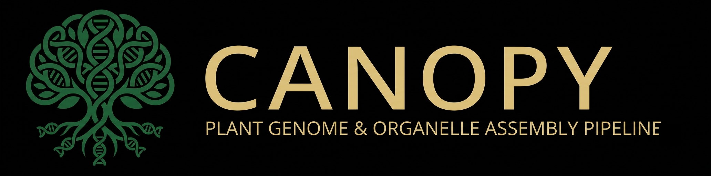
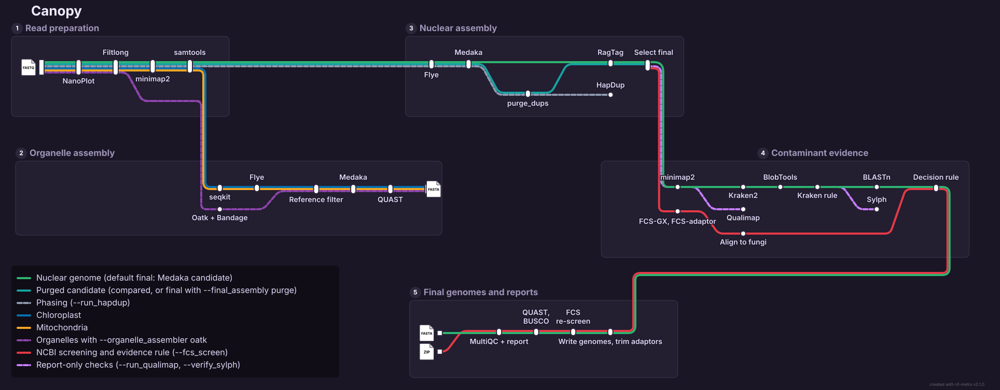

# Canopy

<!-- badges: start -->
[](https://github.com/Gian77/Canopy)
[](https://github.com/Gian77/Canopy/releases)
[](https://github.com/Gian77/Canopy/releases)
[](https://github.com/Gian77/Canopy/issues)
<!-- badges: end -->

<p align="center">
  
</p>

`Canopy` is a [Nextflow](https://www.nextflow.io/) pipeline for plant genome assembly from Oxford
Nanopore (ONT) long reads. It assembles the chloroplast, mitochondrial and nuclear genomes separately,
then screens the nuclear genome for contamination so it is ready for an NCBI submission check. It was
developed on sorghum and is still under active development. The name **Canopy** refers to the upper
layer of a plant: the whole crown that emerges once every branch and leaf is assembled together, much
like a complete genome emerging from thousands of individual long reads.

## Contents

- [Contact](#contact)
- [What Canopy does](#what-canopy-does)
- [Workflow DAG](#workflow-dag)
- [Key parameters](#key-parameters)
- [Directory structure expected](#directory-structure-expected)
- [Running](#running)
- [Results](#results)
- [How contigs are kept or removed](#how-contigs-are-kept-or-removed)
- [Using Canopy on another species](#using-canopy-on-another-species)
- [Sequencing chemistry](#sequencing-chemistry-input-data)
- [Resource classes](#resource-classes-configured-in-nextflowconfig)
- [HPC notes](#hpc-notes-glbrc--htcondor)
- [Containers](#containers)
- [Known limitations](#known-limitations)
- [Clean up](#clean-up)
- [References](#references)

## Contact

Gian M. N. Benucci, Ph.D. — [benucci@msu.edu](mailto:benucci@msu.edu) — Michigan State University

## What Canopy does

For each sample, with the settings the launcher scripts use:

**Read preparation**

1. **Read QC:** NanoPlot on the raw reads.
2. **Read filtering:** Filtlong keeps reads of at least 1 kb with a mean quality of at least 80
   (Filtlong's own 0–100 score, not Phred).
3. **Organelle mapping:** minimap2 (`map-ont`) against the combined chloroplast and mitochondrial
   references.
4. **Read partitioning:** samtools splits reads into chloroplast and mitochondrial sets (primary
   alignments) and a nuclear set (unmapped reads). seqkit removes duplicate read names from the
   organelle sets, and per-compartment read and coverage statistics are recorded.

**Organelle assembly**

5. **Assembly:** Flye per compartment (the default, with a 150 kb chloroplast and 500 kb mitochondrial
   size estimate), or Oatk with `--organelle_assembler oatk`. Oatk uses all filtered reads and the
   pre-built embryophyta OatkDB, and Bandage draws its assembly graphs.
6. **Reference filter:** minimap2 (`asm10`) keeps contigs with matched bases over more than 50% of
   their length at more than 70% identity. This removes nuclear copies of organelle sequence
   (NUPTs and NUMTs). Turn it off with `--filter_organelles false`.
7. **Polishing and QC:** Medaka with the deduplicated organelle reads, then QUAST against the organelle
   reference.

**Nuclear assembly**

8. **Assembly:** Flye on the nuclear reads, using `--genome_size`.
9. **Polishing:** Medaka.
10. **Purge duplicates:** purge_dups always runs, with cutoffs tuned from the coverage peak unless you
    set `--calcuts_args`. The purged genome and the unpurged Medaka genome both continue as candidates.
11. **Phasing (optional):** HapDup with `--run_hapdup`, starting from the purged genome.
12. **Scaffolding (with `--nuclear_ref`):** RagTag `correct` and `scaffold` on both candidates. RagTag
    joins neighbouring contigs with 100 bp gaps.
13. **Selecting the final candidate:** `--final_assembly medaka|purge` (default `medaka`) chooses which
    candidate continues through screening. QUAST and BUSCO score all candidates side by side, which
    exposes over-purging.

**Contaminant evidence (optional, on the selected candidate)**

14. **Read mapping:** minimap2 maps the nuclear reads back to the genome. Qualimap (`--run_qualimap`)
    reports alignment QC, and a primary-alignment BAM feeds BlobTools.
15. **Taxonomy:** Kraken2 against PlusPFP with `--run_kraken2`. BlobTools draws the coverage, GC and
    taxonomy blob plots.
16. **First contaminant call:** with `--flag_contaminants`, contigs are checked for taxonomy, RagTag
    placement and alignment to the nuclear reference.
17. **Independent checks:** Sylph against GTDB (`--verify_sylph`) and BLASTn against a local database
    (`--verify_blast`) on the contigs flagged for removal or review.
18. **NCBI screening:** with `--fcs_screen`, FCS-GX and FCS-adaptor on the full genome, plus minimap2
    (`asm20`) of unplaced contigs against fungal references.

**Final genomes and reports**

19. **Decision rule:** `bin/canopy_contig_rule.py` combines the evidence for every contig, as described
    in [How contigs are kept or removed](#how-contigs-are-kept-or-removed).
20. **Final genomes:** `bin/canopy_write_genomes.py` writes `<sample>_final.fasta` and
    `<sample>_full_flagged.fasta` with their AGPs, trimming adaptor hits from contig ends.
21. **Re-screening:** FCS-GX and FCS-adaptor run again on the final genome. A genome with hits gets one
    more round (`final2`). Hits left after that give `screen_status=CHECK`.
22. **Reports:** MultiQC, a per-sample assembly summary, a tools report, and one zip archive per sample
    that holds the genomes and their evidence.

## Workflow DAG

<p align="center">
  
</p>

Each line follows one kind of data through the stations that process it, and dashed lines are optional.
The map simplifies some details:

- Oatk takes all filtered reads, but the mapping, partitioning and seqkit stations still run in Oatk
  mode because Medaka polishes the organelles with those reads.
- QUAST and BUSCO in section 5 score every nuclear candidate, not only the final genome.
- RagTag and the sections after it depend on `--nuclear_ref`. Without a reference, the candidates are
  the unscaffolded genomes, and the summary and archive are not produced.
- Contaminant evidence also includes alignment of unplaced contigs to the nuclear reference, as part
  of the Kraken rule station.

For the full process-level graph of a run, open `dag.html` in its output directory.

The map is drawn with [nf-metro](https://github.com/seqeralabs/nf-metro) from
[`docs/images/canopy_metro.mmd`](docs/images/canopy_metro.mmd). After changing the workflow, update that
file and render it again. nf-metro draws only a one-line title, so a second command adds the Canopy
header (name in the logo colours, description, and the version from `manifest.version` in
`nextflow.config`):

```bash
pip install nf-metro   # needs Python 3.10 or later; the map was drawn with version 2.1.0
nf-metro render docs/images/canopy_metro.mmd --embed-font -o docs/images/canopy_metro.svg
python3 docs/images/metro_header.py docs/images/canopy_metro.svg nextflow.config
```

## Key parameters

### Inputs and general

| Parameter | Default | Notes |
|---|---|---|
| `--reads` | `${projectDir}/reads` | One sample directory, or a parent directory of sample directories, holding `*.fastq.gz` |
| `--cp_ref` | required | Chloroplast reference FASTA |
| `--mt_ref` | required | Mitochondrial reference FASTA |
| `--nuclear_ref` | none | Nuclear reference FASTA. Enables RagTag, QUAST genome fraction, the summary and the archive |
| `--outdir` | `results` | Output directory |
| `--help` | `false` | Print the usage message and exit |

### Assembly and polishing

| Parameter | Default | Notes |
|---|---|---|
| `--organelle_assembler` | `flye` | `flye` per compartment, or `oatk` for HMM-based read detection |
| `--filter_organelles` | `true` | Reference filter on organelle contigs |
| `--genome_size` | `780m` | Estimated nuclear genome size for Flye |
| `--medaka_model` | `r1041_e82_400bps_sup_v5.2.0` | Must match your chemistry and basecaller |
| `--calcuts_args` | `""` | Manual purge_dups cutoffs such as `"-l 5 -m 22 -u 120"`. Empty tunes them from the coverage peak |
| `--final_assembly` | `medaka` | `medaka` (unpurged) or `purge`. Both are always compared |
| `--ragtag_correct` | `true` | Run `ragtag.py correct` before scaffolding |
| `--run_hapdup` | `false` | Diploid phasing with HapDup |
| `--busco_lineage` | `poales_odb10` | BUSCO lineage dataset |

### QC and contaminant screening

| Parameter | Default | Notes |
|---|---|---|
| `--run_qualimap` | `false` | BAM-level QC on the selected candidate |
| `--run_blobtools` | `false` | Coverage and GC blob plot, without taxonomy |
| `--run_kraken2` | `false` | Kraken2 classification and taxonomy blob plots |
| `--kraken2_db` | PlusPFP path on GLBRC | Kraken2 database, about 231.5 GB when loaded. Downloaded if this path or `--taxdump_dir` is missing |
| `--taxdump_dir` | PlusPFP path on GLBRC | NCBI taxdump (`nodes.dmp`, `names.dmp`) for BlobTools |
| `--kraken2_confidence` | `0.1` | Kraken2 `--confidence`, which reduces spurious calls on long contigs |
| `--flag_contaminants` | `false` | Contaminant rule. Needs `--run_kraken2` and `--nuclear_ref` |
| `--contam_target_phylum` | `Streptophyta` | Phylum treated as on-target |
| `--contam_max_ref_aligned` | `0.10` | A contig aligned to the nuclear reference at or above this fraction is not removed by the alignment-dependent rules |
| `--verify_sylph` | `false` | Sylph check of flagged contigs against GTDB. Needs `--flag_contaminants` |
| `--sylph_db` | `databases/sylph/gtdb-r226-c200-dbv1.syldb` | Downloaded if absent |
| `--sylph_min_ani` | `90` | Minimum adjusted ANI |
| `--verify_blast` | `false` | BLASTn of flagged contigs. Needs `--flag_contaminants` |
| `--blast_db` | `databases/blast/core_nt/core_nt` | Prefix of a local database. Not downloaded, and the run stops if it is missing |
| `--blast_min_identity` | `90` | Minimum percent identity for a hit to corroborate |
| `--blast_min_qcov` | `50` | Minimum query coverage percent, across all alignments to the subject |
| `--blast_max_targets` | `10` | `-max_target_seqs` for BLASTn |

### NCBI screening

| Parameter | Default | Notes |
|---|---|---|
| `--fcs_screen` | `false` | FCS-GX, FCS-adaptor, the decision rule and the final genomes. Needs `--flag_contaminants` and `--verify_blast` |
| `--fcs_gx_db` | `databases/fcs-gx/gxdb` | FCS-GX database, about 465 GB. Not downloaded |
| `--fcs_gx_taxid` | `4558` | NCBI taxid of your organism (*Sorghum bicolor* by default) |
| `--fcs_adaptor_image` | `ncbi/fcs-adaptor:0.5.5` | FCS-adaptor container image |
| `--fungal_refs` | `databases/fungal_refs/fungi.fasta` | Fungal reference FASTA, with IDs prefixed `<species>\|`. Not downloaded |
| `--contam_min_fungal_frac` | `0.5` | Minimum fraction of a contig aligned to a fungal reference |

> `--skip_purge` and `--blast_remote` are retired, and setting either stops the run. BLASTn only searches
> a local database, so assembly sequence is never sent to a remote service.

## Directory structure expected

You provide `reads/`, `refs/` and `databases/`. The other files come with the repository.

```text
Canopy/
├── main.nf                     # top-level workflow
├── nextflow.config             # parameters, resource labels and profiles
├── modules/
│   ├── qc.nf                   # NanoPlot, Filtlong, QUAST, BUSCO, Qualimap, MultiQC, organelle filter
│   ├── mapping.nf              # organelle mapping and read partitioning
│   ├── dbs.nf                  # OatkDB, Kraken2 PlusPFP and Sylph database downloads
│   ├── assembly.nf             # Flye and Oatk
│   ├── polishing.nf            # Medaka, purge_dups, HapDup
│   ├── scaffolding.nf          # RagTag
│   ├── contamination.nf        # Kraken2, BlobTools, Sylph, BLASTn, FCS, decision rule, final genomes
│   └── reports.nf              # summary, tools report, per-sample archive
├── bin/
│   ├── canopy_contig_rule.py   # contaminant decision rule
│   ├── canopy_write_genomes.py # final and flagged genomes, adaptor trimming
│   ├── canopy_merge_trims.py   # merges trim logs across screening rounds
│   ├── canopy_build_release.py # builds a multi-sample release from the archives
│   ├── canopy_report_html.py   # converts the assembly summary to HTML
│   └── condor_submit           # routes task submissions to the scheduler
├── utils/
│   └── quay_tools.sh           # finds and verifies container images
├── docs/images/                # workflow metro map and its source
├── pipeline.condor             # submits one Nextflow head job per sample
├── run_pipeline_condor.sh      # script that each head job runs
├── run_pipeline.sh             # runs the head processes in the background, without Condor jobs
├── run_pipeline.submit         # older submit file; pipeline.condor is preferred
├── watch_pipeline.sh           # follows a Nextflow log
├── reads/                      # you provide
│   ├── sample_A/
│   │   └── *.fastq.gz
│   └── sample_B/
│       └── *.fastq.gz
├── refs/                       # you provide
│   └── sorghum/
│       ├── sorghum_cp_NC008602.fasta
│       ├── sorghum_mt_NC008360.fasta
│       └── Sbicolor_730_v5.0.fa
└── databases/                  # you provide what --verify_blast and --fcs_screen need
    ├── blast/core_nt/
    ├── fcs-gx/gxdb/
    ├── fungal_refs/fungi.fasta
    └── sylph/
```

The directory name under `reads/` becomes the sample name, and all FASTQ files in it are treated as one
sample.

## Running

### Create the Nextflow conda environment

Canopy needs Nextflow, Java and Apptainer. All other tools run in containers, so you install only this
one environment:

```bash
conda create -n nextflow -c conda-forge -c bioconda \
    nextflow=26.04.1 apptainer=1.4.5 openjdk=21
conda activate nextflow

nextflow -version
apptainer --version
```

These are the versions the current results were produced with. `nextflow.config` allows Nextflow 24.04.0
or later, but older versions have not been tested with this code.

The launcher scripts expect the environment at `~/.conda/envs/nextflow`. They do not need it activated.

### Check the setup

```bash
# Check that the configuration parses
nextflow config -profile condor

# Check the wiring without running any process
nextflow run main.nf -preview \
    --cp_ref refs/sorghum/sorghum_cp_NC008602.fasta \
    --mt_ref refs/sorghum/sorghum_mt_NC008360.fasta
```

### One run with your own options

On HTCondor:

```bash
nextflow run main.nf \
    -profile condor \
    --reads reads/sample_A/ \
    --cp_ref refs/sorghum/sorghum_cp_NC008602.fasta \
    --mt_ref refs/sorghum/sorghum_mt_NC008360.fasta \
    --nuclear_ref refs/sorghum/Sbicolor_730_v5.0.fa \
    --outdir results_sample_A \
    -w nf-work-sample_A \
    -resume
```

Without `-profile condor`, tasks run on the local machine. The resource classes still apply, so that needs
a machine with at least 448 GB of RAM for the nuclear assembly, and 700 GB for FCS-GX.

To run the full screening, add:

```bash
    --run_qualimap true \
    --run_blobtools true \
    --run_kraken2 true \
    --flag_contaminants true \
    --verify_sylph true \
    --verify_blast true \
    --fcs_screen true
```

### All samples on HTCondor

Run this from the submit node, `scarcity-ap-1`. It submits one independent Nextflow head job per sample:

```bash
condor_submit pipeline.condor
condor_q
```

Alternatively, `bash run_pipeline.sh` starts the same head processes in the background with `nohup`.

Both use the same settings: Flye for organelles, every screening step including `--fcs_screen`, and no
HapDup. Each sample gets:

| Path | Contents |
|---|---|
| `results_<sample>${OUTDIR_SUFFIX}/` | Published results |
| `nf-work-<sample>/` | Nextflow task directories and cache |
| `.canopy-run-<sample>/` | Launch directory with `.nextflow/` and `.nextflow.log` |
| `condor_logs/` | Head-job logs |

Environment variables change a whole batch:

```bash
# Keep a run apart from earlier results; tasks cached in nf-work-<sample>/ are still reused
OUTDIR_SUFFIX=_v5 condor_submit pipeline.condor

# Continue with the purged genome instead of the Medaka genome
FINAL_ASSEMBLY=purge condor_submit pipeline.condor
```

The launchers contain paths and sample names specific to our setup. Before using them elsewhere, update:

- `HOME`, `PROJECT_DIR` and the reference paths in `run_pipeline_condor.sh` and `run_pipeline.sh`
- `initialdir` and the `queue sample in ...` line in `pipeline.condor`
- the `case` list of allowed samples in `run_pipeline_condor.sh`
- the `SAMPLES` line in `run_pipeline.sh`

To run a subset, edit the sample lists the same way.

### Follow and stop a run

```bash
./watch_pipeline.sh .canopy-run-F10702/.nextflow.log
condor_rm <cluster_id>     # stops head jobs submitted with pipeline.condor
```

### Resume after a failure

The launchers already use `-resume`, so submit them again. Nextflow reuses cached tasks and reruns only what
changed or failed. With your own commands, always add `-resume` and keep the same `-w` directory.

Editing `bin/canopy_contig_rule.py` or `bin/canopy_write_genomes.py` invalidates every later task, because
they are task inputs. That includes QUAST, which takes about 2 hours per genome.

### Enable HapDup phasing

Add `--run_hapdup true` to your command. The launchers do not set it.

### Build a multi-sample release

Build releases from the per-sample archives, not from `assembly/final/`, which an aborted run can leave
truncated. The script checks each genome against its stats and writes checksums.

```bash
python3 bin/canopy_build_release.py \
    --release results_release \
    --results-pattern 'results_{sample}_v5' \
    --samples sample_A sample_B \
    --readme path/to/release_README.md
```

`--readme` is the file to install as the release's `README.md`, and `--extra-evidence` optionally adds a
directory of per-contig evidence tables. Check a release with `sha256sum -c MANIFEST.sha256` from inside
it.

## Results

Every archive at `results_<sample>/reports/<sample>/<sample>_assembly.zip` holds what you need to review
one genome, in a small download. With `--fcs_screen`:

| File | Contents |
|---|---|
| `<sample>_final.fasta`, `.agp` | Nuclear genome to use, with contaminants removed and adaptors trimmed |
| `<sample>_full_flagged.fasta`, `.agp` | Every sequence, with its decision and evidence in the headers |
| `<sample>_chloroplast.fasta` | Chloroplast assembly |
| `<sample>_mitochondria.fasta` | Mitochondrial assembly |
| `<sample>_assembly_summary.md` | Assembly report |
| `<sample>_contig_decisions.tsv` | Decision, rule and evidence for each contig |
| `<sample>_adapter_trims.tsv` | Adaptor trims applied |
| `<sample>_blast_corroboration.tsv`, `<sample>_sylph_corroboration.tsv` | Independent check results |
| `screening/` | FCS-GX and FCS-adaptor reports for the full and final genomes, and `<sample>_ncbi_screen.txt` |
| `blobtools/` | Blob plots, table and coverage |
| `quast_*_report.html`, `busco_nuclear_final_summary.txt` | Assembly QC |
| `pipeline_tools.md` | Tools report |

Without `--fcs_screen`, the nuclear genome is `<sample>_nuclear.fasta`, with removed contigs in
`<sample>_removed_contigs.fasta`, and the decisions are in `<sample>_contamination_audit.tsv`.

The results directory also holds:

| Path | Contents |
|---|---|
| `assembly/` | Organelle, nuclear, scaffold and final assemblies |
| `polishing/` | Medaka, purge_dups and HapDup output |
| `qc/` | NanoPlot, read-set statistics, QUAST, BUSCO, Qualimap, Kraken2, BlobTools, contamination evidence |
| `reads_filtered/`, `reads_partitioned/` | Filtered and partitioned reads |
| `mapping/` | Organelle mapping statistics |
| `multiqc/` | MultiQC report |
| `pipeline_report.html`, `timeline.html`, `trace.txt`, `dag.html` | Nextflow execution records |

As a guide, our five sorghum genomes used about 35–130 GB of published results and 135–265 GB of work
directory per sample.

## How contigs are kept or removed

Canopy never removes a contig placed on a chromosome by RagTag. Only unplaced contigs can be removed.

With `--flag_contaminants` alone, the published genome comes from the **Kraken rule**. It removes a contig
when all three of these hold:

- BlobTools and Kraken2 assign it a phylum other than `--contam_target_phylum`.
- RagTag left it unplaced.
- Less than `--contam_max_ref_aligned` of it aligns to the nuclear reference.

Unplaced, unaligned contigs with no taxonomy call stay in the genome and are listed for review. In this
mode Sylph and BLASTn are advisory.

With `--fcs_screen`, the published genome comes from the **decision rule**. It removes an unplaced contig
when any of these holds, checked in this order:

| Rule | Condition |
|---|---|
| `R1_fcs_exclude` | FCS-GX action is `EXCLUDE` |
| `R2_fcs_review` | FCS-GX action is `REVIEW`, and the Kraken rule, fungal alignment or BLASTn agrees |
| `R3_kraken_blast` | The Kraken rule says remove, and BLASTn corroborates |
| `R4_fungal_alignment` | At least `--contam_min_fungal_frac` aligns to a fungal reference, and less than `--contam_max_ref_aligned` aligns to the nuclear reference |
| `R5_blast` | BLASTn corroborates, and less than `--contam_max_ref_aligned` aligns to the nuclear reference |

**BLASTn is not advisory in this mode**, because R2, R3 and R5 use it. Sylph stays advisory. GC and coverage
are recorded for interpretation but never trigger removal, because they overlapped between plant and
contaminant contigs in the sorghum genomes.

A contig stays in the genome for review if it has an unresolved FCS-GX call or Kraken flag. A placed contig
with an FCS-GX call also stays, and the count is reported.

FCS-adaptor hits are trimmed from contig ends in both genome versions, and the AGP is rebuilt so scaffold
gaps stay 100 bp. A hit more than 1 kb from a contig end stops the run, because it could mark a chimeric
join that trimming would not fix. `+` in sequence names becomes `plus`, because NCBI and FCS do not accept
it.

`screen_status=PASS` in the report means the last FCS-GX and FCS-adaptor screens of the final genome have no
hits. It is not a complete NCBI submission check: see [Known limitations](#known-limitations).

## Using Canopy on another species

Canopy has only been tested on sorghum. For another plant, check at least these:

| Setting | Why |
|---|---|
| `--cp_ref`, `--mt_ref`, `--nuclear_ref` | References for your species |
| `--genome_size` | Nuclear size estimate for Flye |
| `--busco_lineage` | Lineage that matches your species |
| `--fcs_gx_taxid` | FCS-GX uses this to decide what counts as foreign |
| `--contam_target_phylum` | Keep `Streptophyta` for land plants, and change it for other groups |
| `--fungal_refs` | The defaults are the two fungi found in these samples: *Rhizopus delemar* (GCF_000149305.1) and *Aspergillus niger* (GCF_000002855.4) |
| `--medaka_model` | Must match your chemistry and basecaller |
| Flye organelle sizes | The 150 kb and 500 kb estimates are set in `modules/assembly.nf` |
| `notification.to` in `nextflow.config` | Address that receives run completion emails |

## Sequencing chemistry (input data)

All reads processed by this pipeline so far are ONT **V14 chemistry**, sequenced on a **FLO-PRO114M
(R10.4.1)** flow cell. Basecalling was **simplex only**, because MinKNOW's on-instrument software does not
offer live duplex basecalling, and used the **Super-accurate basecalling (SUP), 400 bps** model. That is why
`--medaka_model` defaults to an `r1041_e82_400bps_sup_*` model. If you sequence with different chemistry, a
different flow cell, or a different basecaller speed or accuracy, choose the matching Medaka model.

## Resource classes (configured in nextflow.config)

A **label** is a named resource class. Each process in `modules/` declares one, such as `label 'polish'`, and
the matching `withLabel: 'polish'` block in `nextflow.config` sets the CPUs, memory and time limit that
Nextflow requests for it, plus any node requirements. To change what a group of processes gets, edit that
block rather than each process.

| Label | CPUs | RAM | Time | Node limits | Used by |
|---|---:|---:|---:|---|---|
| `qc_light` | 8 | 32 GB | 12 h | | NanoPlot, Filtlong, decision rule, genome writing and refinement, screen summary, tools report |
| `qc` | 16 | 128 GB | 12 h | | MultiQC, QUAST (nuclear), Qualimap, BlobTools, read deduplication and statistics, Kraken rule, candidate extraction, contaminant removal, Sylph, FCS-adaptor, summary, archive |
| `qc_heavy` | 16 | 128 GB | 24 h | | BUSCO, BLASTn |
| `map` | 24 | 128 GB | 12 h | | All minimap2 and samtools alignment steps, read partitioning, organelle reference filter |
| `assemble_small` | 16 | 128 GB | 6 h | | Flye (organelles), Oatk, RagTag, QUAST (organelles) |
| `assemble_heavy` | 32 | 448 GB | 120 h | `scarcity-1`–`5`, `9`, `11`–`13`, `20` | Flye (nuclear), HapDup, Kraken2 |
| `polish` | 24 | 256 GB | 48 h | Not `scarcity-9` | Medaka, purge_dups |
| `fcs_gx` | 48 | 700 GB | 12 h | `scarcity-12` only | FCS-GX |
| `fetch` | 2 | 8 GB | 48 h | | Database downloads |

`BANDAGE_IMAGE` sets its own resources (1 CPU, 4 GB). Without a label, a process would get the defaults of
8 CPUs, 32 GB and 4 h.

- **Retries:** tasks that end with exit code 132, 137, 139, 143 or 247 (illegal instruction, out of memory,
  timeout and similar) retry up to twice, with the same resources.
- **Kraken2:** it uses `assemble_heavy` so the PlusPFP index fits in RAM. Memory mapping over CephFS never
  finished in our tests.
- **Other clusters:** adjust these values to your queue limits and node capacity. The node limits are specific
  to our cluster, so remove them elsewhere.

## HPC notes (GLBRC / HTCondor)

Canopy was developed on the GLBRC `scarcity` HTCondor cluster, and so far that is the only system where it has
been tested. On other systems, expect to change the executor profile, the node requirements in
`nextflow.config`, the launcher paths and `bin/condor_submit`.

- **Submit node:** Nextflow head processes must run on `scarcity-ap-1`, because they submit the tasks and only
  dispatch work. `pipeline.condor` uses `universe = local` for this.
- **Scheduler routing:** `bin/condor_submit` sends task submissions to `scarcity-ap-1.glbrc.org`. Set
  `CANOPY_CONDOR_SCHEDD` to use a different scheduler.
- **Disk space:** the work directory is large (see [Results](#results)), so put it on storage with enough room
  and pass it with `-w`. The default is `~/nf-work-sorghum`, so set it explicitly.
- **Container cache:** images are stored in `~/.apptainer_cache`. The first run downloads all of them.
- **Excluded node:** `scarcity-14` is excluded for all processes, as a known bad node.
- **`scarcity-9`:** its older CPU makes Medaka die with an illegal instruction (exit 132), so the `polish` label
  excludes it. It still handles `assemble_heavy` work.
- **FCS-GX:** it holds its database of about 470 GiB in `/dev/shm`, which is limited to half of a node's RAM.
  That is why only `scarcity-12` is allowed: `scarcity-20` has too little, and `scarcity-9` and `-11` leave no
  margin.
- **Interrupted runs:** `-resume` reuses cached tasks but does not overwrite published files, so an aborted run
  can leave a truncated file in the results directory. The per-sample archive is built from task outputs, so
  [build releases](#build-a-multi-sample-release) from it.

### Keep an interactive session alive

`pipeline.condor` needs none of this. If you run Nextflow directly, use `tmux`:

```bash
tmux new -s canopy
cd /path/to/Canopy
nextflow run main.nf -profile condor ...
```

Press `Ctrl-B`, then `D` to detach and leave it running. To scroll through the output, press `Ctrl-B`, then `[`,
and `q` to leave scroll mode. To reconnect and to close the session later:

```bash
ssh scarcity-ap-1.glbrc.org
tmux attach -t canopy

tmux kill-session -t canopy
```

`bash run_pipeline.sh` already detaches with `nohup`. Follow it with these:

```bash
tail -f condor_logs/pipeline.stdout.txt
tail -f condor_logs/<sample>.stdout.txt
```

## Containers

Every tool runs in a container, pinned to an exact tag in `modules/`. See [References](#references) for the
versions. Canopy pulls the images itself, so you only need this section when changing one.

**Verify an image on the cluster nodes before changing a tag.** An image can exist and still fail: for example,
`quay.io/biocontainers/flye:2.9.6--py313h7fbb527_1` dies with `SIGILL` (illegal CPU instruction) on our compute
nodes, so Canopy uses `flye:2.9.4--py310h2b6aa90_0`.

### Find and verify a single-tool image

[`utils/quay_tools.sh`](utils/quay_tools.sh) ships with the pipeline for this. It needs `curl` and `python3`, and
`verify_image` also needs `apptainer`.

```bash
source utils/quay_tools.sh

# List available tags
quay_tags flye

# Check that a tag exists, without downloading it
image_exists quay.io/biocontainers/flye:2.9.4--py310h2b6aa90_0

# Pull it into a temporary SIF, run a command, then discard it
verify_image quay.io/biocontainers/flye:2.9.4--py310h2b6aa90_0 "flye --version"
```

Set `VERIFY_VERBOSE=1` to see pull errors. You can also browse the tags on quay.io, for example at
<https://quay.io/repository/biocontainers/flye?tab=tags>.

### Find an image with more than one tool

Search the BioContainers hash table, then paste the packages into <https://midnighter.github.io/mulled> to get the
image:

```bash
curl -sO https://raw.githubusercontent.com/BioContainers/multi-package-containers/master/combinations/hash.tsv
grep -E "^minimap2=.*samtools=|^samtools=.*minimap2=" hash.tsv
```

## Known limitations

- **Organelle filter options:** `--organelle_min_qcov` and `--organelle_min_ident` are accepted but have no effect.
  The filter uses fixed thresholds of 0.5 and 0.7.
- **Not yet an automatic NCBI pass:** sequences under 200 bp are not removed, and organelle assemblies are not
  screened with FCS. Handle both before submission.
- **R5 and BLASTn:** the docstring in `bin/canopy_contig_rule.py` describes a non-plant hit, but corroboration checks
  identity and coverage only, not the taxon of the hit. Review `R5_blast` removals in `<sample>_contig_decisions.tsv`.
- **Report section 7:** the Sylph and BLASTn totals count Kraken-rule candidates only, so contigs removed by FCS-GX
  alone are not included.
- **Report gaps:** `pipeline_tools.md` does not list tool versions, and read figures in the report are for the raw read
  set rather than the nuclear reads.
- **Reference-guided scaffolds:** RagTag order and orientation follow the reference, so they cannot reveal real
  structural differences between your sample and the reference.

## Clean up

**Delete carefully.** The work directories hold the Nextflow cache, and they may hold the only complete copy of
intermediate files if a run was interrupted while publishing. After you remove them, the next run starts from the
beginning. Final genomes in a release do not depend on them.

```bash
# Task directories and cache
rm -rf nf-work-*

# Nextflow session state in the launch directories
rm -rf .nextflow/ .canopy-run-*/
rm -f .nextflow.log*

# Published results: back up anything you want to keep first
rm -rf results results_*/

# Container image cache
apptainer cache list -v
apptainer cache clean
```

## References

Please cite the tools you use. Versions are the ones pinned in `modules/` and used for the current results.

### Workflow and containers

| Tool | Version | Reference |
|---|---|---|
| Nextflow | 26.04.1 | Di Tommaso P, et al. Nextflow enables reproducible computational workflows. *Nat Biotechnol* 2017;35:316–319. [doi:10.1038/nbt.3820](https://doi.org/10.1038/nbt.3820) |
| Apptainer (Singularity) | 1.4.5 | Kurtzer GM, et al. Singularity: Scientific containers for mobility of compute. *PLoS ONE* 2017;12:e0177459. [doi:10.1371/journal.pone.0177459](https://doi.org/10.1371/journal.pone.0177459) |
| BioContainers | | da Veiga Leprevost F, et al. BioContainers: an open-source and community-driven framework for software standardization. *Bioinformatics* 2017;33:2580–2582. [doi:10.1093/bioinformatics/btx192](https://doi.org/10.1093/bioinformatics/btx192) |
| nf-metro | 2.1.0 | Workflow map. <https://github.com/seqeralabs/nf-metro> |

### Read processing and mapping

| Tool | Version | Reference |
|---|---|---|
| NanoPlot | 1.43.0 | De Coster W, Rademakers R. NanoPack2: population-scale evaluation of long-read sequencing data. *Bioinformatics* 2023;39:btad311. [doi:10.1093/bioinformatics/btad311](https://doi.org/10.1093/bioinformatics/btad311) |
| Filtlong | 0.2.1 | Wick R. <https://github.com/rrwick/Filtlong> |
| minimap2 | 2.30 (2.31 for HapDup) | Li H. Minimap2: pairwise alignment for nucleotide sequences. *Bioinformatics* 2018;34:3094–3100. [doi:10.1093/bioinformatics/bty191](https://doi.org/10.1093/bioinformatics/bty191). Li H. New strategies to improve minimap2 alignment accuracy. *Bioinformatics* 2021;37:4572–4574. [doi:10.1093/bioinformatics/btab705](https://doi.org/10.1093/bioinformatics/btab705) |
| SAMtools | 1.21 (1.6 for HapDup) | Danecek P, et al. Twelve years of SAMtools and BCFtools. *GigaScience* 2021;10:giab008. [doi:10.1093/gigascience/giab008](https://doi.org/10.1093/gigascience/giab008) |
| SeqKit | 2.13.0 | Shen W, et al. SeqKit: a cross-platform and ultrafast toolkit for FASTA/Q file manipulation. *PLoS ONE* 2016;11:e0163962. [doi:10.1371/journal.pone.0163962](https://doi.org/10.1371/journal.pone.0163962). Shen W, et al. SeqKit2: a Swiss army knife for sequence and alignment processing. *iMeta* 2024;3:e191. [doi:10.1002/imt2.191](https://doi.org/10.1002/imt2.191) |

### Assembly, polishing and scaffolding

| Tool | Version | Reference |
|---|---|---|
| Flye | 2.9.4 | Kolmogorov M, et al. Assembly of long, error-prone reads using repeat graphs. *Nat Biotechnol* 2019;37:540–546. [doi:10.1038/s41587-019-0072-8](https://doi.org/10.1038/s41587-019-0072-8) |
| Oatk | 1.0 | Zhou C, et al. Oatk: a de novo assembly tool for complex plant organelle genomes. *Genome Biol* 2025;26:235. [doi:10.1186/s13059-025-03676-6](https://doi.org/10.1186/s13059-025-03676-6) |
| Bandage | 0.9.0 | Wick RR, et al. Bandage: interactive visualization of de novo genome assemblies. *Bioinformatics* 2015;31:3350–3352. [doi:10.1093/bioinformatics/btv383](https://doi.org/10.1093/bioinformatics/btv383) |
| Medaka | 2.2.1 | Oxford Nanopore Technologies. <https://github.com/nanoporetech/medaka> |
| purge_dups | 1.2.6 | Guan D, et al. Identifying and removing haplotypic duplication in primary genome assemblies. *Bioinformatics* 2020;36:2896–2898. [doi:10.1093/bioinformatics/btaa025](https://doi.org/10.1093/bioinformatics/btaa025) |
| HapDup | 0.12 | Kolmogorov M, et al. Scalable Nanopore sequencing of human genomes provides a comprehensive view of haplotype-resolved variation and methylation. *Nat Methods* 2023;20:1483–1492. [doi:10.1038/s41592-023-01993-x](https://doi.org/10.1038/s41592-023-01993-x) |
| RagTag | 2.1.0 | Alonge M, et al. Automated assembly scaffolding using RagTag elevates a new tomato system for high-throughput genome editing. *Genome Biol* 2022;23:258. [doi:10.1186/s13059-022-02823-7](https://doi.org/10.1186/s13059-022-02823-7) |

### QC and contaminant screening

| Tool | Version | Reference |
|---|---|---|
| QUAST | 5.3.0 | Gurevich A, et al. QUAST: quality assessment tool for genome assemblies. *Bioinformatics* 2013;29:1072–1075. [doi:10.1093/bioinformatics/btt086](https://doi.org/10.1093/bioinformatics/btt086). Mikheenko A, et al. Versatile genome assembly evaluation with QUAST-LG. *Bioinformatics* 2018;34:i142–i150. [doi:10.1093/bioinformatics/bty266](https://doi.org/10.1093/bioinformatics/bty266) |
| BUSCO | 5.8.0 | Manni M, et al. BUSCO update: novel and streamlined workflows along with broader and deeper phylogenetic coverage for scoring of eukaryotic, prokaryotic, and viral genomes. *Mol Biol Evol* 2021;38:4647–4654. [doi:10.1093/molbev/msab199](https://doi.org/10.1093/molbev/msab199) |
| Qualimap | 2.3 | Okonechnikov K, et al. Qualimap 2: advanced multi-sample quality control for high-throughput sequencing data. *Bioinformatics* 2016;32:292–294. [doi:10.1093/bioinformatics/btv566](https://doi.org/10.1093/bioinformatics/btv566) |
| MultiQC | 1.25.1 | Ewels P, et al. MultiQC: summarize analysis results for multiple tools and samples in a single report. *Bioinformatics* 2016;32:3047–3048. [doi:10.1093/bioinformatics/btw354](https://doi.org/10.1093/bioinformatics/btw354) |
| Kraken 2 | 2.1.3 | Wood DE, et al. Improved metagenomic analysis with Kraken 2. *Genome Biol* 2019;20:257. [doi:10.1186/s13059-019-1891-0](https://doi.org/10.1186/s13059-019-1891-0) |
| BlobTools | 1.1.1 | Laetsch DR, Blaxter ML. BlobTools: interrogation of genome assemblies. *F1000Research* 2017;6:1287. [doi:10.12688/f1000research.12232.1](https://doi.org/10.12688/f1000research.12232.1) |
| Sylph | 0.9.0 | Shaw J, Yu YW. Rapid species-level metagenome profiling and containment estimation with sylph. *Nat Biotechnol* 2025;43:1348–1359. [doi:10.1038/s41587-024-02412-y](https://doi.org/10.1038/s41587-024-02412-y) |
| BLAST+ | 2.15.0 | Camacho C, et al. BLAST+: architecture and applications. *BMC Bioinformatics* 2009;10:421. [doi:10.1186/1471-2105-10-421](https://doi.org/10.1186/1471-2105-10-421) |
| FCS-GX | 0.4.1 | Astashyn A, et al. Rapid and sensitive detection of genome contamination at scale with FCS-GX. *Genome Biol* 2024;25:60. [doi:10.1186/s13059-024-03198-7](https://doi.org/10.1186/s13059-024-03198-7) |
| FCS-adaptor | 0.5.5 | NCBI Foreign Contamination Screen. <https://github.com/ncbi/fcs> |

### Databases and references

| Resource | Version | Source |
|---|---|---|
| Kraken2 PlusPFP | Build 2026-06-26 | Prebuilt index. <https://benlangmead.github.io/aws-indexes/k2> |
| GTDB (Sylph sketch) | R226 | Parks DH, et al. GTDB: an ongoing census of bacterial and archaeal diversity through a phylogenetically consistent, rank normalized and complete genome-based taxonomy. *Nucleic Acids Res* 2022;50:D785–D794. [doi:10.1093/nar/gkab776](https://doi.org/10.1093/nar/gkab776) |
| NCBI `core_nt` | Local copy | <https://ftp.ncbi.nlm.nih.gov/blast/db/> |
| FCS-GX database | Build 2023-01-24 | <https://github.com/ncbi/fcs/wiki/FCS-GX> |
| OatkDB | v20230921, embryophyta | <https://github.com/c-zhou/OatkDB> |
| BUSCO lineage | `poales_odb10` | <https://busco-data.ezlab.org/v5/data/lineages/> |
| Fungal references | GCF_000149305.1, GCF_000002855.4 | *Rhizopus delemar* and *Aspergillus niger*, NCBI RefSeq |
| Sorghum organelles | NC_008602, NC_008360 | Chloroplast and mitochondrion, NCBI RefSeq |
| Sorghum nuclear | `Sbicolor_730_v5.0` | *Sorghum bicolor* v5.0, Phytozome |
